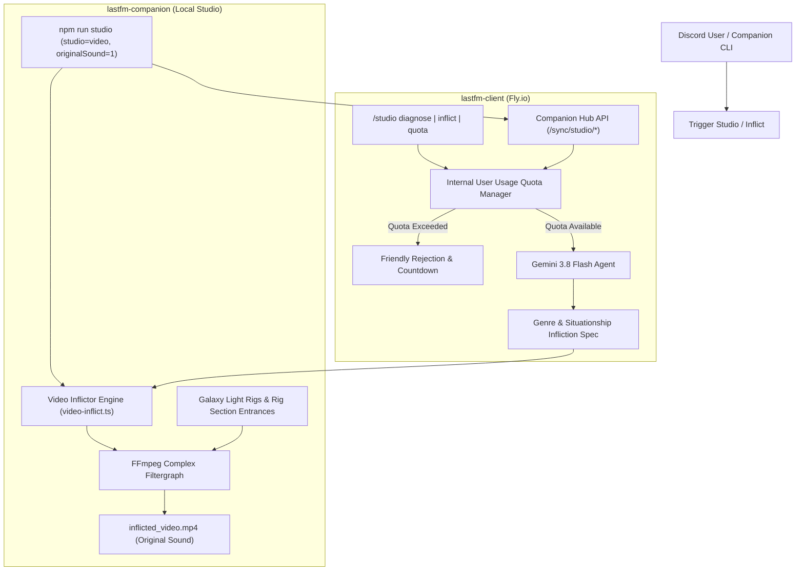

# Multi-Video Infliction Studio & Rig Plan

## 1. Overview & Objectives

This feature extends the **Studios & Rigs** architecture in `discord-aibot-monorepo` (`lastfm-companion` and `lastfm-client`) to allow **multiple videos to be inflicted upon each other** driven by:
1. **Genre Diagnosis**: Deep sonic & aesthetic classification (rhythm, aggression, harmonic tension, visual motifs).
2. **Situationships Diagnosis**: Interpersonal & thematic tension analysis (e.g. *Toxic Entanglement*, *Push-Pull Dissonance*, *Unrequited Orbit*, *Ghosting Drift*, *Soulmate Fusion*).
3. **Gemini 3.8 Flash Agent with Internal User Usage Quota**: Structured reasoning engine that generates the infliction choreography and enforces per-user quotas to prevent API exhaustion.
4. **Video-Only & Original Sound Execution**:
   - `videoOnly`: Bypasses heavyweight MIDI stem rendering and Reaper scripts when the user only wants the video studio output.
   - `originalSound`: Preserves the authentic high-fidelity track or source audio stream (`-c:a copy` or 320 kbps AAC) instead of synthesising General MIDI soundfont audio.

---

## 2. Architecture & Component Interaction

---

## 3. Gemini 3.8 Flash Agent & Situationship Diagnosis

### Inputs Analyzed:
- **Track Attributes**: Title, Artist, Last.fm tags, GetSongBPM genres, BPM, Key, Time Signature, Danceability, Acousticness, Wiki/Summary.
- **Video Metadata**: Two or more video inputs (filenames, visual descriptions, thematic tags).

### Diagnosis Output Schema:
- `genreProfile`:
  - `primaryGenre`: e.g. "Hyperpop / Glitch-Core"
  - `energy`: 0.0 - 1.0
  - `aestheticPalette`: Array of hex colors for the galaxy rigs
  - `visualTempoFactor`: Modulation speed for cuts and flashes
- `situationship`:
  - `type`: `entanglement` | `push_pull` | `unrequited` | `ghosting` | `limbo` | `soulmate_fusion`
  - `headline`: e.g. "Chaotic Late-Night Entanglement"
  - `dissonanceScore`: 0 - 100%
  - `narrativeDiagnosis`: 2-sentence summary of why this dynamic fits the music & video collision
- `inflictionChoreography`:
  - `blendMode`: `difference` | `exclusion` | `hardlight` | `screen` | `overlay` | `chroma_bleed`
  - `collisionRate`: Beat intervals for video collision (e.g. every downbeat, every 2 bars)
  - `stutterGlitch`: boolean (whether to inject stroboscopic frame-holds on snare/clap hits)
  - `hudBadgeText`: Formatted label displayed on the HUD

---

## 4. Internal User Usage Quota System

To protect API budgets and provide fair access:
- **Default Quota**: 5 video diagnoses per user per rolling 24-hour window (configurable via `STUDIO_USER_QUOTA_LIMIT` and `STUDIO_USER_QUOTA_WINDOW_MS`).
- **Internal State**: In-memory ring buffer with timestamped usage entries per user ID (compatible with Discord IDs and CLI user tokens).
- **Graceful Feedback**:
  - Informs the user of remaining runs: `3/5 remaining (resets in 4h 12m)`.
  - Blocks when exceeded with exact cooldown timestamp.
  - Admin bypass for server managers or configured admin user IDs.

---

## 5. Video-Only & Original Sound FFmpeg Filtergraph

### Multi-Video Infliction Pipeline:
1. **Inputs**:
   - `Input 0`: Audio source (the original high-fidelity song file or master stream)
   - `Input 1`: Video A (primary visual stream, scaled to 1280x720)
   - `Input 2`: Video B (secondary visual stream, scaled to 1280x720)
   - `Input 3`: Galaxy Beam Sprite (generated procedural light beam)
2. **Filtergraph Operations**:
   - **Beat & Bar Calculations**: `beat = 60 / bpm`, `bar = beat * beatsPerBar`
   - **Situationship Infliction Blending**:
     - At regular bar/beat pulses determined by the diagnosis, Video B is inflicted onto Video A using the chosen blend mode (e.g. `blend=all_mode=difference` or `overlay` with dynamic opacity `enable='...'`).
   - **Galaxy Light Rig Sweeps**:
     - Rig A and Rig B sweep across the stage floor in mirrored synchrony with the diagnosed palette colors.
   - **Audio Reactivity**:
     - Waveform + CQT audio spectrum rendered on top of the composite.
   - **Dynamic HUD Overlays**:
     - Song facts, Genre badge, Situationship diagnosis headline, and rig entrance notifications.
   - **Audio Passthrough**:
     - `-c:a copy` or `-c:a aac -b:a 320k` ensuring the **original sound** is completely preserved.
